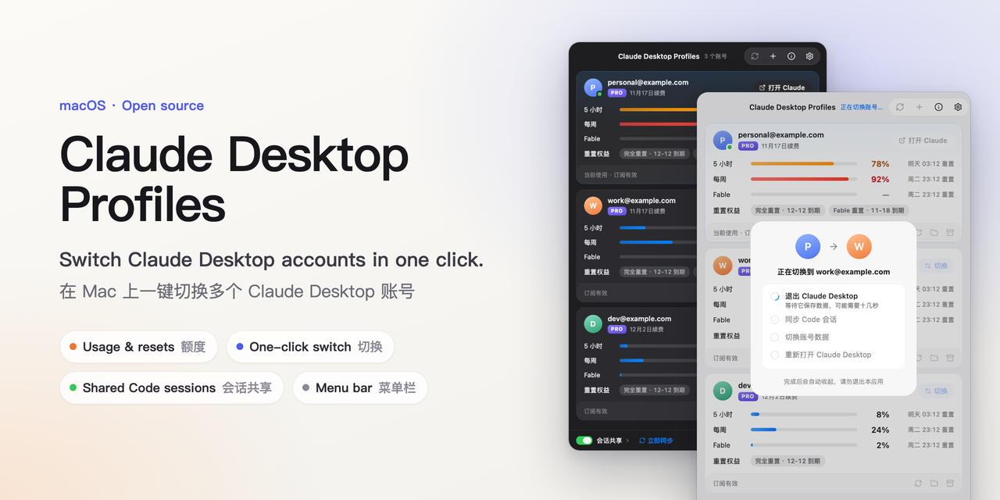

# Claude Desktop Profiles

English | [简体中文](README.zh-CN.md)



A native macOS menu bar app for people who use more than one Claude Desktop account. See every account's usage at a glance, switch with one click, and keep your Claude Code sessions available in every account.

> Claude Desktop Profiles is an independent, community-built tool. It is not made, endorsed or supported by Anthropic. Claude is a trademark of Anthropic.

## Features

- **One window for all accounts.** Each account gets a card with its email, plan badge (FREE, PRO, MAX, ULTRA, TEAM, ENTERPRISE), billing channel and renewal date. The account in use is pinned to the top.
- **Usage and resets.** Shows the 5-hour, weekly and per-model limits, with the time each one resets. Bars turn orange at 70% and red at 90%. Available usage resets are listed with their type and expiry date.
- **One-click switching.** Claude Desktop is quit cleanly, the account data is swapped and the app is reopened. A progress panel shows each step as it happens.
- **Adding accounts.** Claude Desktop opens in a fresh environment so you can sign in. The new account is detected automatically, and duplicates are flagged. You can give up and go back to the previous account at any time.
- **Shared Claude Code sessions.** Local Code sessions are merged across accounts, while each account keeps its own sign-in. Permission modes stay the same after a switch, and you won't be asked to resume imported sessions again. A session browser shows which accounts already have each session.
- **Menu bar.** Lists every account with its current usage. From there you can switch accounts, refresh, toggle session sharing or open the window. Closing the window keeps the app running in the menu bar only, without a Dock icon; the icon comes back with the window.
- **Exit IP check.** Shows the IP address, country, city and ASN that Claude traffic leaves from, using the same proxy settings as Claude Desktop.
- **Automatic updates.** Release builds update themselves from GitHub Releases through Sparkle, and every update's signature is checked.
- **Light and dark mode**, following your system setting.

## Requirements

- macOS on Apple Silicon. Intel Macs and Windows are not supported yet.
- [Claude Desktop](https://claude.ai/download), installed and signed in at least once.

## Installation

1. Download the latest `.dmg` from [Releases](https://github.com/gopkg-dev/claude-desktop-profiles/releases) and drag the app to Applications.
2. Releases are signed ad hoc and not notarized by Apple, so macOS blocks the app the first time you open it. Go to **System Settings › Privacy & Security** and click **Open Anyway**.
3. The first time you refresh usage, macOS asks whether the app may read the **Claude Safe Storage** keychain item. Enter your login password and choose **Always Allow**. The app needs this to read Claude Desktop's existing sign-in. It never stores or changes your credentials. After each update macOS asks once more, because the new version has a new signature.

## How it works

- **Accounts.** Each account is a saved copy of Claude Desktop's data folder. To switch, the app quits Claude Desktop, moves the folders and reopens it. If something fails partway, the switch is rolled back on the next launch.
- **Online data.** Account details and usage are fetched from Anthropic's API with the OAuth credentials Claude Desktop already has. The app never signs in, renews tokens or changes anything on the server.
- **No automatic requests by default.** Refreshing is manual unless you turn on auto-refresh in Settings (every 1, 5, 15 or 60 minutes). Each account is refreshed at most once a minute, and failures back off exponentially. Cooldowns are kept across restarts.
- **Region check.** Before any request that uses credentials, the app checks the exit region against Anthropic's [supported regions](https://www.anthropic.com/legal/supported-regions). If the region isn't supported, the request is stopped.

### Data on your Mac

| What | Where |
| --- | --- |
| Claude Desktop's current data | `~/Library/Application Support/Claude/` |
| Saved accounts, settings and cache | `~/Library/Application Support/Claude Profiles/` |
| Claude Code session transcripts | `~/.claude/projects/` |
| HTTP logs | `~/Library/Logs/Claude Profiles/HTTP/` |

The cache holds no tokens. **HTTP logs are raw and include authorization headers.** They are only readable by you (folders `0700`, files `0600`) and are capped at the last 100 exchanges (20 MiB). You can clear them from Settings, and you shouldn't share them.

## Documentation

The detailed docs are in Chinese:

- [User guide](docs/user-guide.md)
- [Local Code session sharing](docs/workspace-sharing.md)

## Building from source

You need macOS, Go 1.27.3 and the Xcode Command Line Tools. Go and [NSGo](https://github.com/nsgo-dev/nsgo) fetch everything else on the first build.

```sh
make dev          # development mode with hot reload (same as go tool nsgo dev)
make run          # build and launch a packaged app
make test         # all Go tests, with the race detector
make vet          # go vet
make lint         # staticcheck
make test-native  # native UI tests
make build        # build the app and DMG into dist/
make release      # build a DMG and Sparkle appcast signed for updates
```

Builds are signed with the local `Apple Development` certificate named in `nsgo.yaml`. Keep using the same certificate so macOS remembers your keychain approval. If you don't have one, `go tool nsgo build -target macos_arm64 -sign -` makes an ad-hoc build.

To refresh once on launch, for example from a script, start the packaged app with `--refresh-once`. It runs the same steps as the refresh button and respects the cooldowns.

### Continuous integration

GitHub Actions runs on macOS (Apple Silicon):

- **CI** (`.github/workflows/ci.yml`) runs on every push to `main` and on every pull request. It checks gofmt, then runs `go vet`, staticcheck and `go test -race`, and builds an ad-hoc signed DMG. The DMG is kept as a workflow artifact for 14 days and is meant for checking the build, not for distribution.
- **Release** (`.github/workflows/release.yml`) runs when a `v*` tag is pushed. It builds the DMG and Sparkle appcast and publishes them as a release right away.
- **NSGo update check** (`.github/workflows/nsgo-update.yml`) runs every Monday and can also be started by hand. NSGo has no tagged releases, so Dependabot can't follow it. The workflow compares the pinned NSGo commit with NSGo's `main` branch. If `main` is newer, it tries the upgrade (`go build`, `go vet`, and the tests of the `tools/nsgo` signing adapter, which patches NSGo's source) and opens or updates a single "NSGo update available" issue with the result. It never commits anything.
- **Dependabot** checks the workflow actions monthly and groups all updates into one pull request.

### Releasing

1. Update the version in `nsgo.yaml` and `main.go`.
2. Tag and push the commit, for example `git tag v0.7.0 && git push origin v0.7.0`. The workflow stops if the tag doesn't match both versions.
3. The workflow publishes the release when it finishes. Installed copies read the latest release's appcast, so they are offered the update straight away: only push the tag once the version is ready to ship.

The release workflow needs one repository secret, `NSGO_UPDATES_KEY`: the private key for signing updates. Set it from the keychain without printing it:

```sh
security find-generic-password -s claude-desktop-profiles-updates -w | gh secret set NSGO_UPDATES_KEY
```

Releases are signed ad hoc, so no Apple certificate is needed and the app's signature contains no personal details. Updates are verified with the EdDSA update key instead. Because an ad-hoc signature changes with every build, macOS asks users again for access to Claude Safe Storage after each update.

To release by hand instead, run `make release`. It also signs ad hoc, reads the update key from the login keychain, and writes the DMG, its `.sha256` and `appcast-macos_arm64.xml` to `dist/releases/`. Upload all of these files to the release; without the appcast, installed copies won't find the update.

`updates.key` in `nsgo.yaml` is the public key. The private key must never be committed. Back it up: if it's lost, installed copies can't verify any future update.

## Project layout

```text
main.go           entry point
nsgo.yaml         NSGo build and packaging settings
assets/           app icon, social preview image and design notes
desktopui/        native UI, menu bar and UI tests
profiles/         account folders, switching and recovery, online cache and refresh limits
desktopdriver/    quitting and launching Claude Desktop
desktopauth/      reading and decrypting Claude Desktop's local credentials
desktopusage/     account and usage API, exit IP and geolocation, proxy, TLS and raw capture
httplog/          private raw HTTP log files with rotation
workspaces/       local Code session sharing
tools/nsgo/       NSGo command adapter that keeps dev builds signed
docs/             user guide and design notes (Chinese)
```

## License

[MIT](LICENSE)
