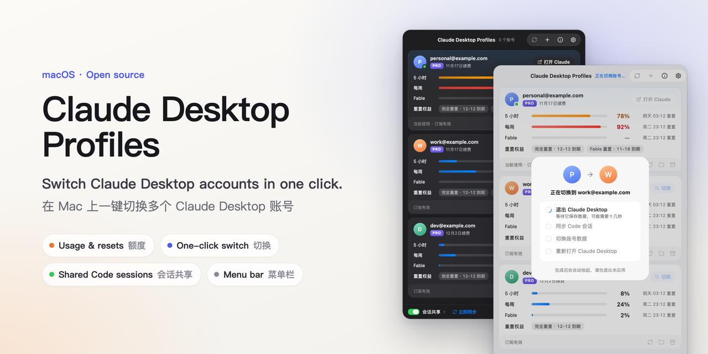

# Claude Desktop Profiles

[English](README.md) | 简体中文



一个 macOS 原生的菜单栏应用，适合同时使用多个 Claude Desktop 账号的人：一眼看清每个账号的额度，一键切换，让 Claude Code 会话在所有账号里都能继续用。

> Claude Desktop Profiles 是社区开发的独立工具，并非 Anthropic 出品，也未获 Anthropic 认可或支持。Claude 是 Anthropic 的商标。

## 功能

- **一个窗口管理全部账号**：每个账号一张卡片，显示邮箱、套餐徽章（FREE、PRO、MAX、ULTRA、TEAM、ENTERPRISE）、订阅渠道和续费日。当前使用的账号排在最前。
- **额度与重置权益**：显示 5 小时、每周和各模型额度，以及各自的重置时间；用量到 70% 变橙，到 90% 变红。可用的重置权益会标明类型和到期日。
- **一键切换**：先正常退出 Claude Desktop，再换好账号数据并重新打开。进度面板会逐步显示每一步。
- **添加账号**：Claude Desktop 以全新环境打开，供你登录。登录完成后自动识别新账号，重复的账号会被标出。随时可以放弃添加，切回原来的账号。
- **共享 Claude Code 会话**：在账号之间合并本地 Code 会话，各账号的登录环境互不影响。切换后权限模式保持不变，也不会再弹出恢复已导入会话的提示。会话管理页可以查看每个会话已经同步到了哪些账号。
- **菜单栏**：列出所有账号及其当前用量，可以直接切换账号、在线刷新、开关会话共享或打开主窗口。关闭窗口后应用会驻留在菜单栏。
- **出口 IP**：沿用 Claude Desktop 的代理设置，查询 Claude 流量的出口 IP、国家、城市和 ASN。
- **在线更新**：发布版通过 Sparkle 从 GitHub Releases 自动更新，每次更新都会校验签名。
- **浅色 / 深色**：跟随系统设置。

## 系统要求

- Apple Silicon 芯片的 macOS。暂不支持 Intel Mac 和 Windows。
- 已安装 [Claude Desktop](https://claude.ai/download)，并至少登录过一次。

## 安装

1. 从 [Releases](https://github.com/gopkg-dev/claude-desktop-profiles/releases) 下载最新的 `.dmg`，把应用拖进「应用程序」。
2. 发布版使用临时签名，没有经过 Apple 公证，所以第一次打开时 macOS 会阻止运行。到 **系统设置 › 隐私与安全性** 里点 **仍要打开** 即可。
3. 第一次在线刷新时，macOS 会询问是否允许读取钥匙串里的 **Claude Safe Storage**。输入登录密码并选择 **始终允许**。应用需要它来读取 Claude Desktop 已有的登录凭证，不会保存或修改你的凭证。每次更新后 macOS 会再问一次，因为新版本的签名变了。

## 工作方式

- **账号**：每个账号是一份保存起来的 Claude Desktop 数据目录。切换时，应用先退出 Claude Desktop，再移动目录，然后重新打开它。如果中途出错，下次启动时会自动回滚。
- **在线数据**：账号资料和额度来自 Anthropic 的接口，使用的是 Claude Desktop 已有的 OAuth 凭证。应用不会登录、不续期令牌，也不修改服务端的任何数据。
- **默认不自动请求**：刷新默认是手动的，除非你在设置里打开自动刷新（有效期可选 1、5、15、60 分钟）。同一账号至少间隔 1 分钟才能再次刷新，失败后按指数退避重试，冷却状态在重启后依然保留。
- **地区检查**：每次使用凭证发请求之前，应用都会核对出口地区是否在 Anthropic 的[支持地区](https://www.anthropic.com/legal/supported-regions)之内；不在范围内就停止请求。

### 本机数据

| 内容 | 路径 |
| --- | --- |
| Claude Desktop 当前数据 | `~/Library/Application Support/Claude/` |
| 保存的账号、设置和缓存 | `~/Library/Application Support/Claude Profiles/` |
| Claude Code 会话正文 | `~/.claude/projects/` |
| HTTP 日志 | `~/Library/Logs/Claude Profiles/HTTP/` |

缓存里不包含令牌。**HTTP 日志是原始记录，包含认证头。** 日志只有你自己能读（目录权限 `0700`，文件 `0600`），最多保留最近 100 次请求、总计 20 MiB。可以在设置页清空日志，请不要把它们发给别人。

## 文档

- [使用说明](docs/user-guide.md)
- [本地 Code 会话共享](docs/workspace-sharing.md)

## 从源码构建

需要 macOS、Go 1.27.3 和 Xcode Command Line Tools。首次构建时，Go 和 [NSGo](https://github.com/nsgo-dev/nsgo) 会自动准备其余依赖。

```sh
make dev          # 开发模式，支持热重载（等同于 go tool nsgo dev）
make run          # 构建并启动打包版
make test         # 全部 Go 测试，开启 race 检查
make vet          # go vet
make lint         # staticcheck
make test-native  # 原生界面测试
make build        # 构建应用和 DMG，输出到 dist/
make release      # 构建带更新签名的 DMG 和 Sparkle appcast
```

构建使用 `nsgo.yaml` 里指定的本机 `Apple Development` 证书签名。请始终用同一张证书，macOS 才会记住你在钥匙串里的授权。如果没有证书，可以用 `go tool nsgo build -target macos_arm64 -sign -` 做临时签名构建。

如果想在启动时自动刷新一次（比如在脚本里调用），给打包版加上 `--refresh-once` 参数。它和刷新按钮走同一流程，同样遵守冷却时间。

### 持续集成

GitHub Actions 在 macOS（Apple Silicon）上运行：

- **CI**（`.github/workflows/ci.yml`）：每次推送到 `main` 和每个 Pull Request 都会运行。先检查 gofmt，再跑 `go vet`、staticcheck 和 `go test -race`，然后构建一个临时签名的 DMG。这个 DMG 作为工作流产物保留 14 天，只用来确认能构建成功，不用于分发。
- **Release**（`.github/workflows/release.yml`）：推送 `v*` 标签时运行。它构建 DMG 和 Sparkle appcast，并直接发布为 Release。
- **NSGo 更新检查**（`.github/workflows/nsgo-update.yml`）：每周一自动运行，也可以手动触发。NSGo 没有打 tag 的发布版，Dependabot 跟踪不了它，所以由这个工作流比较项目锁定的 NSGo 提交和 NSGo 的 `main` 分支。如果 `main` 更新，它会试着升级：跑 `go build`、`go vet`，以及 `tools/nsgo` 签名适配器的测试（这个适配器会给 NSGo 源码打补丁）。然后新建或更新一个"NSGo update available" issue 报告结果。它不会提交任何代码。
- **Dependabot**：每月检查一次工作流用到的 Actions，所有升级合并成一个 PR。

### 发布新版本

1. 修改 `nsgo.yaml` 和 `main.go` 里的版本号。
2. 给这个提交打标签并推送，例如 `git tag v0.7.0 && git push origin v0.7.0`。如果标签和这两处的版本号不一致，工作流会停止。
3. 工作流跑完就会直接发布 Release。已安装的应用读取的是最新 Release 里的 appcast，会马上收到更新提示，所以请确认版本可以上线后再推送标签。

Release 工作流只需要一个仓库 Secret：`NSGO_UPDATES_KEY`，即更新签名私钥。用下面的命令从钥匙串直接写入，私钥不会显示在屏幕上：

```sh
security find-generic-password -s claude-desktop-profiles-updates -w | gh secret set NSGO_UPDATES_KEY
```

发布版使用临时签名（ad hoc），不需要 Apple 证书，签名里也不含任何个人信息；更新包的真实性由 EdDSA 更新签名校验。临时签名每次构建都不同，所以每次更新后，macOS 都会再次询问是否允许访问 Claude Safe Storage。

也可以手动发布：运行 `make release`。它同样使用临时签名，从登录钥匙串读取更新签名私钥，在 `dist/releases/` 生成 DMG、对应的 `.sha256` 和 `appcast-macos_arm64.xml`。把这些文件全部上传到 Release；缺少 appcast 的话，已安装的应用找不到更新。

`nsgo.yaml` 里的 `updates.key` 是公钥，可以公开。私钥绝不能提交到仓库。请务必备份私钥：一旦丢失，已安装的版本将无法验证之后的任何更新。

## 项目结构

```text
main.go           应用入口
nsgo.yaml         NSGo 构建与打包配置
assets/           应用图标、社交分享图和设计说明
desktopui/        原生界面、菜单栏和界面测试
profiles/         账号目录、切换与恢复、在线缓存与刷新频率
desktopdriver/    退出和启动 Claude Desktop
desktopauth/      读取并解密 Claude Desktop 的本地凭证
desktopusage/     账号与额度接口、出口 IP 与地理位置、代理、TLS 与原始抓包
httplog/          私有的原始 HTTP 日志文件及轮转
workspaces/       本地 Code 会话共享
tools/nsgo/       NSGo 命令适配，让开发构建保持签名
docs/             使用说明和设计文档
```

## 许可证

[MIT](LICENSE)
